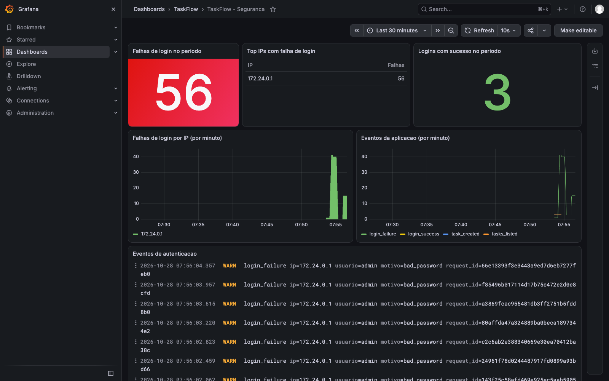
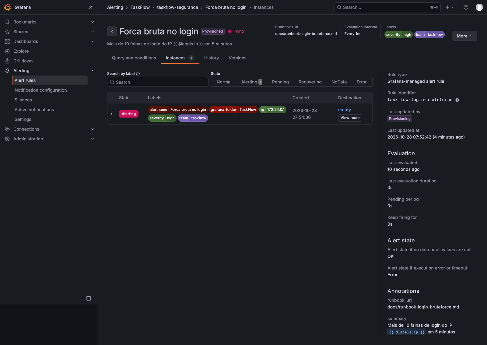
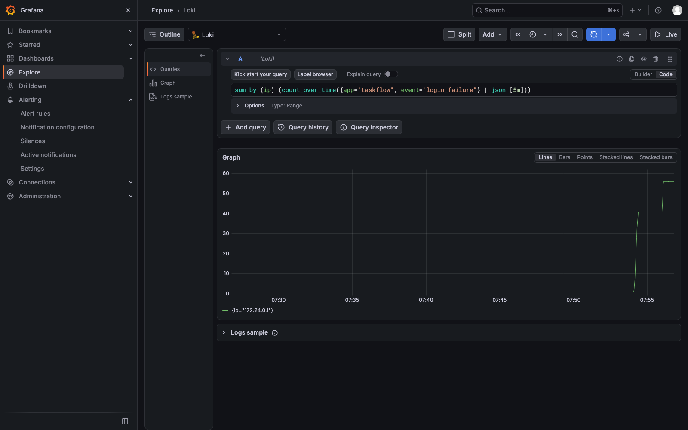

# Observabilidade: logs JSON, Loki e Grafana

Stack: [docker-compose.yml](../docker-compose.yml) (profile `observabilidade`) · Configurações: [observability/](../observability/) · Runbook: [runbook-login-bruteforce.md](runbook-login-bruteforce.md)

## Como subir

```bash
cp .env.example .env          # troque todos os valores, inclusive GRAFANA_ADMIN_PASSWORD
docker compose --profile observabilidade up -d --build --wait
```

- Aplicação: `http://127.0.0.1:8000`
- Grafana: `http://127.0.0.1:3000`, usuário `admin` e a senha do `.env`. O dashboard **TaskFlow → TaskFlow - Seguranca** e o alerta **Forca bruta no login** já vêm provisionados.

Sem `--profile observabilidade`, sobem só a app e o Postgres (é assim que o DAST usa o compose).

## Arquitetura

```
 app (web) ──grava JSON──▶ volume app_logs ──lê (ro)──▶ Promtail ──push──▶ Loki ◀──consulta── Grafana ──▶ 127.0.0.1:3000
```

- A app **não fala com o Loki**: ela grava no volume `app_logs`, e o Promtail lê esse volume como somente leitura. Assim nenhum serviço monta o `docker.sock`.
- Loki e Promtail ficam na rede `observability`, que é `internal: true` (sem acesso à internet). Só o Grafana publica porta, e só em `127.0.0.1`.
- Os três serviços rodam com `read_only`, `cap_drop: ALL`, `no-new-privileges`, limites de CPU, memória e PIDs e usuários não-root.
- O Grafana usa só os plugins que vêm na imagem (`GF_PLUGINS_PREINSTALL_DISABLED`). Sem isso, o Grafana 13 tenta atualizar o plugin do Loki pela internet ao iniciar e, com o filesystem somente leitura, fica sem o datasource.
- O Loki não tem healthcheck: a imagem é distroless, sem shell nem cliente HTTP. Promtail e Grafana têm.

## Formato do log

Um objeto JSON por linha, no stdout e em `/app/logs/taskflow.log`:

```json
{"ts": "2026-10-28T10:49:05.076+00:00", "level": "warning", "logger": "taskflow", "message": "login_failure", "event": "login_failure", "request_id": "556a77148cdf48958a50222ce42c5b1e", "ip": "172.23.0.1", "username": "admin", "reason": "bad_password"}
```

| Evento | Quando | Campos |
|--------|--------|--------|
| `http_request` | Toda requisição, exceto `/healthz` | `method`, `path`, `status`, `duration_ms` |
| `login_success` | Login válido | `user_id`, `username` |
| `login_failure` | Login inválido | `username` (até 64 caracteres), `reason` (`bad_password` ou `unknown_user`) |
| `logout` | Logout | `user_id` |
| `task_created` | Nova tarefa | `user_id`, `task_id` |
| `tasks_listed` | Listagem de tarefas | `user_id`, `count`, `has_search` |
| `csrf_rejected` | `POST` sem token CSRF válido | `path` |
| `invalid_input` | Parâmetro com byte NUL (`\x00`), rejeitado com 400 antes de chegar ao Postgres | `path` |

Todos os eventos levam `request_id` (UUID por requisição, também devolvido no cabeçalho `X-Request-ID`) e `ip`.

**O que nunca vai para o log:** `request.form`, senha, cookie, token CSRF e termo de busca. O `JsonFormatter` só grava campos de uma lista fixa (`FIELDS` em `app.py`), então um dado sensível não chega ao log nem se for passado por engano. O `path` é registrado sem query string.

O Promtail transforma só `level` e `event` em labels (poucos valores possíveis). `ip`, `username` e `request_id` ficam no corpo e são extraídos com `| json` na consulta, para não explodir a cardinalidade do Loki.

## Consultas LogQL

Todas foram executadas na stack local depois de um ataque com `scripts/bruteforce.sh`.

**1. Falhas de login por IP (5 minutos).** É a consulta do alerta e do runbook.

```logql
sum by (ip) (count_over_time({app="taskflow", event="login_failure"} | json [5m]))
```

No teste dos prints abaixo, todas as falhas vieram de `172.24.0.1`, o gateway da rede Docker (ver [Limitações](#limitações)).

**2. Top 10 IPs com falha de login no período do painel.**

```logql
topk(10, sum by (ip) (count_over_time({app="taskflow", event="login_failure"} | json [$__range])))
```

**3. Usuários atacados e motivo da falha.** Muitos `unknown_user` indicam enumeração de usuários; muitos `bad_password` no mesmo usuário indicam ataque direcionado.

```logql
sum by (username, reason) (count_over_time({app="taskflow", event="login_failure"} | json [15m]))
```

**4. Login com sucesso vindo do IP atacante** (possível comprometimento):

```logql
{app="taskflow", event="login_success"} | json | ip="172.24.0.1"
```

**5. Eventos por tipo (por minuto).**

```logql
sum by (event) (count_over_time({app="taskflow"} [1m]))
```

**6. Respostas 4xx e 5xx por rota.**

```logql
sum by (path, status) (count_over_time({app="taskflow", event="http_request"} | json | status >= 400 [15m]))
```

**7. Tudo o que aconteceu numa requisição.**

```logql
{app="taskflow"} | json | request_id="1d95d27710e146b9b609830a1c1931c6"
```

## Ataque de força bruta

```bash
./scripts/bruteforce.sh http://127.0.0.1:8000 admin 30
```

O script pega um token CSRF novo a cada tentativa, testa uma lista de senhas comuns e para se alguma funcionar. Ele recusa qualquer alvo que não seja `127.0.0.1` ou `localhost`.

Em até um minuto o alerta **Forca bruta no login** passa para *Firing* com o label `ip` do atacante, e o dashboard mostra o pico.

### Prints

| | |
|-|-|
| Dashboard durante o ataque |  |
| Alerta disparado |  |
| Consulta de falhas por IP no Explore |  |

## Limitações

- **IP de origem:** a app usa `request.remote_addr`. Atrás do Docker, todo acesso vindo do host aparece com o IP do gateway da rede (ex.: `172.24.0.1`; o número muda quando a rede é recriada). Em produção, atrás de um proxy, é preciso o `ProxyFix` do Werkzeug configurado só para o proxy confiável; ler `X-Forwarded-For` sem isso deixaria o atacante forjar o IP.
- **Promtail descontinuado:** a Grafana substituiu o Promtail pelo Alloy. Usamos o Promtail porque é o que a disciplina pede; a migração seria trocar só esse serviço.
- **Retenção:** 7 dias no Loki (`retention_period: 168h`).
